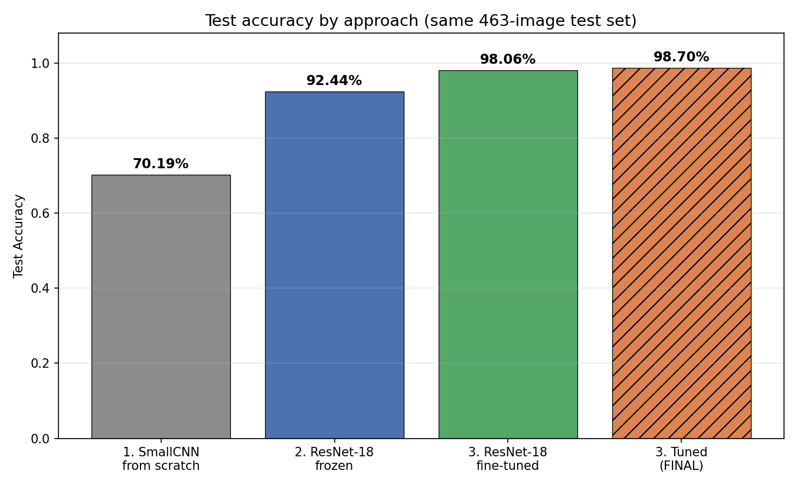
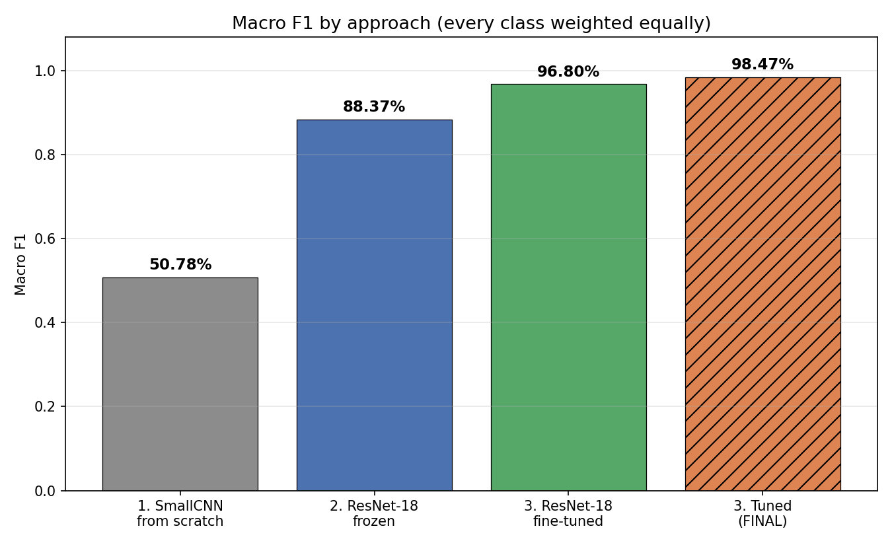
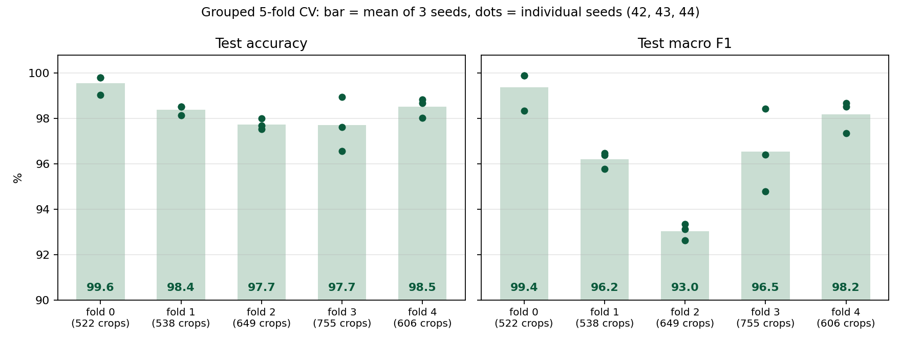
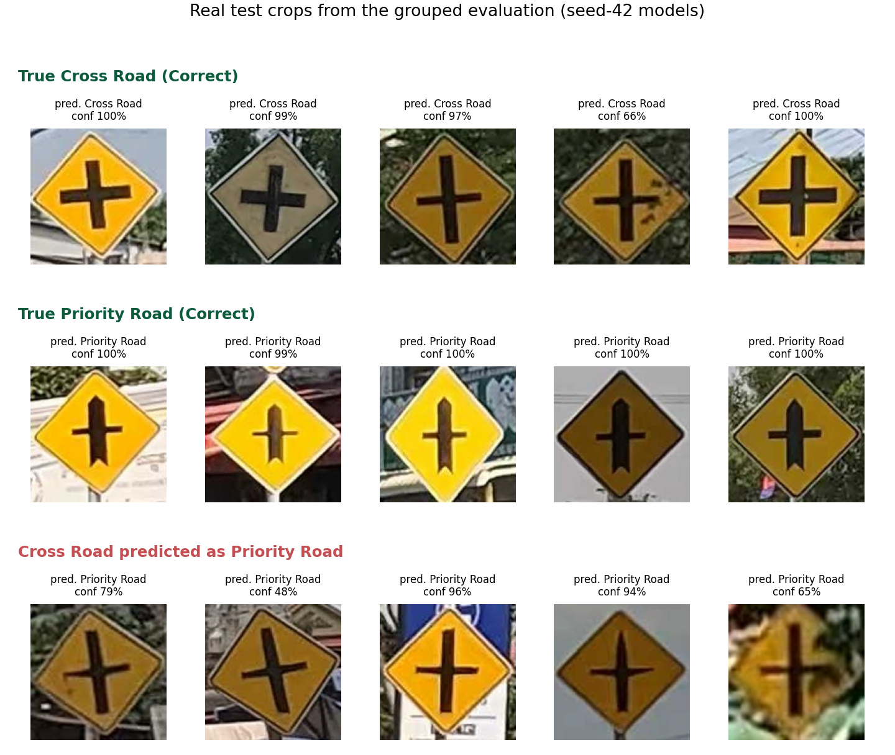

# Road Sign Recognition Using Deep Learning

**Author:** Tes Sothyroth

## 1. Project Overview

This project develops and compares deep learning approaches for recognising Cambodian traffic signs.

**Task:** Image classification (one cropped traffic sign → one of 26 classes)  
**Dataset:** Cambodia Traffic Signs Dataset (CamTSD)  
**Framework:** PyTorch  
**Final model:** ResNet-18 pretrained on ImageNet, fully fine-tuned and hyperparameter-tuned. It reaches **98.70% test accuracy** and **98.47% macro F1** on a held-out test set of 463 sign crops.

Three approaches of increasing transfer-learning strength are compared on exactly the same data split:

1. A small CNN trained from scratch
2. ResNet-18 with a frozen ImageNet-pretrained backbone
3. ResNet-18 with full fine-tuning, which is then hyperparameter-tuned

**Follow-up work** (kept separate from the main comparison above, because each uses a different evaluation):

- **Grouped evaluation by drive (Section 9):** the final configuration re-trained and tested with grouped 5-fold cross-validation × 3 seeds, so every test crop comes from a drive the model never saw. Pooled accuracy **98.31% ± 0.20**, macro F1 **97.24% ± 0.68**. This is a different protocol from the 98.70% above, not a before/after comparison.
- **Extension: YOLO sign detector + pipeline (Section 10):** a separate YOLOv8 model finds signs in full street photos, and the final classifier names each detected sign. 445 of 463 test signs (96.11%) are both found and correctly classified.

## 2. Problem Statement

Traffic sign recognition is a core computer-vision task for driver assistance and intelligent transportation systems. Cambodian traffic signs include country-specific classes, such as kilometre posts with Khmer text, alongside several look-alike junction and bend signs. The available data is also small and strongly imbalanced.

The goal is to find out how much each level of transfer learning helps on this small, imbalanced dataset, measured fairly on a test set that is never used for model selection.

## 3. Dataset and Source

**Source:** [Cambodia Traffic Signs Dataset](https://www.kaggle.com/datasets/sophalratitya/cambodia-traffic-signs-dataset) by Sophal Ratitya on Kaggle (`sophalratitya/cambodia-traffic-signs-dataset`, version 1). **License: Apache 2.0**, as stated on the Kaggle dataset page. The raw release contains 2,766 street-scene images and 3,490 bounding-box sign annotations in VIA JSON format (`CAM_TSR_v3_json.json`).

**From raw annotations to classification crops:**

- Only the 26 target classes are kept. **`UNDEFINED` annotations (117 in the raw data) are excluded.**
- Each remaining bounding box is cropped from its source photo, giving **3,070 sign crops** from **2,523 source images**.
- Classes are strongly imbalanced, from 738 crops (`KM_POST`) down to 29 crops (`CARRIAGE_WAY_NARROWS`).

**Leak-free split at source-image level.** Many photos contain more than one sign: 627 raw images contain multiple annotated signs. If crops were split randomly, two crops from the *same photo* (same lighting, camera and background) could end up in both training and test data, which inflates test scores.

To prevent this, **the split is made on the original source images, before cropping**. Every crop then goes to the split of the photo it came from. The 70 / 15 / 15 split uses seed 42:

| Split | Crops | Source images |
|---|---:|---:|
| Train | 2,153 | 1,766 |
| Validation | 454 | 378 |
| Test | 463 | 379 |
| **Total** | **3,070** | **2,523** |

- **Zero parent-image overlap** between train, validation and test (verified).
- Exactly 26 classes, no `UNDEFINED` class.
- The fixed split is committed as manifests in `dataset/splits/{train,val,test}.csv`. They use portable relative paths such as `train/KM_POST/<crop>.jpg`, so every experiment uses the identical split on any machine.

**Later finding:** splitting by source photo does not separate consecutive **video frames**. Most photos are frames of GoPro videos, and 84 of the 463 test crops (18.1%) have a same-class training crop from the same video at most 2 s away. See Section 9.1; the grouped evaluation in Section 9 addresses this.

The raw images and the cropped dataset are not stored in this repository. They are kept on Google Drive (see Section 12).

## 4. Data Preprocessing

Implemented in `src/data/transforms.py` and shared by all approaches:

- **Training:**
  - resize to **224 × 224**
  - random rotation (±10°)
  - colour jitter (brightness 0.15, contrast 0.15, saturation 0.10)
  - ImageNet normalisation
- **Validation and test:** resize to 224 × 224 and ImageNet normalisation only. This is deterministic and identical for every approach.
- **No horizontal flipping:** flipping can change a sign's meaning, e.g. left bend vs. right bend, or junction on the left vs. on the right.

## 5. Deep Learning Approaches

All approaches use the same split, preprocessing and training protocol:
- seed 42 and batch size 32
- cross-entropy loss and the Adam optimizer
- up to 40 epochs, with `ReduceLROnPlateau` on validation accuracy and early stopping after 10 epochs without improvement
- the **best-validation checkpoint** is kept, and the test set is evaluated **once**, after the model is selected

| Approach | Notebook | Model code |
|---|---|---|
| 1. CNN from scratch | `notebooks/02_cnn_from_scratch.ipynb` | `src/models/cnn.py` → `SmallCNN` |
| 2. ResNet-18 frozen backbone | `notebooks/03_resnet18_frozen.ipynb` | `src/models/resnet.py` → `create_resnet18_frozen` |
| 3. ResNet-18 fully fine-tuned | `notebooks/04_resnet18_finetuned.ipynb` | `src/models/resnet.py` → `create_resnet18_finetuned` |

### 5.1 Small CNN from Scratch
- **Architecture:** three convolutional blocks (Conv → BatchNorm → ReLU → MaxPool, with 32 / 64 / 128 channels), then global average pooling and a 256-unit fully connected layer with dropout 0.5, leading to 26 outputs.
- **No pretrained weights:** every one of the **133,178 parameters** is learned from the training split.

### 5.2 ResNet-18 with Frozen Backbone
- **Starting point:** ResNet-18 with ImageNet weights (`ResNet18_Weights.IMAGENET1K_V1`).
- **New classifier:** the 1000-class layer is replaced by `Linear(512, 26)`.
- **What trains:** only that layer (**13,338 trainable parameters**). The backbone acts as a fixed feature extractor, and its BatchNorm layers stay in evaluation mode so the ImageNet statistics are preserved.

### 5.3 ResNet-18 with Full Fine-Tuning
- **Starting point:** the same ImageNet weights and the same new `Linear(512, 26)` classifier.
- **What trains:** **all 11,189,850 parameters**, so the convolutional features themselves adapt to Cambodian traffic signs.

## 6. Hyperparameter Tuning

Notebook: `notebooks/05_hyperparameter_tuning.ipynb`. Tuning was applied to the best baseline, Approach 3.

**Search space (a 2 × 2 grid, everything else fixed):**

| Config | Learning rate | Weight decay (regularisation) |
|---|---:|---:|
| A | 1e-3 | 1e-4 (baseline settings) |
| **B** | **1e-3** | **1e-3** |
| C | 1e-4 | 1e-4 |
| D | 1e-4 | 1e-3 |

**Protocol:**
- Every configuration was trained on the training set and compared **only on validation accuracy**. Ties were broken by validation loss, using a rule fixed before the runs.
- **The test set was not used during tuning.** It was evaluated once, for the selected configuration only, after the selection was made.

**Validation results** (from [`tuning_results.csv`](results/hyperparameter_tuning/resnet18_finetuned_lr_wd_seed42/metrics/tuning_results.csv)):

| Config | Learning rate | Weight decay | Best validation accuracy | Validation loss at best epoch | Best epoch | Training time |
|---|---:|---:|---:|---:|---:|---:|
| A | 1e-3 | 1e-4 | 99.78% (453/454) | 0.0290 | 8 | 3.9 min |
| **B** | **1e-3** | **1e-3** | **99.78% (453/454)** | **0.0280** | **14** | **5.5 min** |
| C | 1e-4 | 1e-4 | 99.78% (453/454) | 0.0330 | 3 | 2.9 min |
| D | 1e-4 | 1e-3 | 99.78% (453/454) | 0.0324 | 3 | 3.0 min |

**All four configurations tied at 99.78% validation accuracy (453 of 454 validation crops correct).** Validation accuracy therefore could not separate them. **Config B** (learning rate 0.001, weight decay 0.001) was selected by the pre-defined tie-break rule: it had the lowest validation loss at its best epoch (0.02796). Config B did **not** reach a higher validation accuracy than the other configurations. The tuning study mainly shows that all four settings performed equally well on the validation set.

## 7. Final Results

All numbers are on the same held-out test set of **463 crops**, which was never used for training or model selection.

| Approach | Test Accuracy | Macro F1 | Trainable Parameters | Training Time |
|---|---:|---:|---:|---:|
| 1. Small CNN from scratch | 70.19% | 50.78% | 133,178 | 8.1 min |
| 2. ResNet-18, frozen backbone | 92.44% | 88.37% | 13,338 | 5.5 min |
| 3. ResNet-18, fully fine-tuned (**untuned baseline**, lr 1e-3, wd 1e-4) | 98.06% | 96.80% | 11,189,850 | 4.0 min |
| **3. ResNet-18, fully fine-tuned + tuned (FINAL MODEL, lr 1e-3, wd 1e-3)** | **98.70%** | **98.47%** | **11,189,850** | **5.5 min** |

Training time of the final model is that of its selected tuning run, Config B: 332.2 s (`best_config.training_time_sec` in [`final_metrics.json`](results/hyperparameter_tuning/resnet18_finetuned_lr_wd_seed42/metrics/final_metrics.json)). The whole 4-configuration search took about 15.4 min in total. All runs used an NVIDIA Tesla T4 GPU on Google Colab.

**Final tuned model, all test metrics:**

| Metric | Value |
|---|---:|
| Test accuracy | 98.70% |
| Macro precision | 98.72% |
| Macro recall | 98.36% |
| **Macro F1** | **98.47%** |
| Weighted F1 | 98.69% |

**Baseline vs. tuned (Approach 3):**
- **Test accuracy:** 98.06% (untuned baseline) → **98.70%** (tuned final model), **+0.65 percentage points**. That is 454 → 457 of 463 test crops correct, i.e. **3 additional correct predictions**.
- **Macro F1:** 96.80% → **98.47%**, **+1.66 percentage points** (exact difference 1.664 pp, as in `results/final_comparison/tuning_improvement.csv`).

These differences come from a single training run per configuration with one seed (42), on a 463-image test set. No repeated runs or significance tests were carried out, so a difference of 3 test images may be within run-to-run variation. It should be read as "tuning did not hurt, and the selected model was slightly better on this test set", not as evidence that the tuned settings are reliably better.

Macro F1 is the mean of the 26 per-class F1 scores, so every class counts equally regardless of size. Macro precision and macro recall are averaged the same way.

**Discussion:**
- **Transfer learning is the largest factor.** Moving from a CNN trained from scratch to frozen ImageNet features raises test accuracy from 70.19% to 92.44%.
- **Fine-tuning adds a further large gain**, mostly on the rarer classes: macro F1 rises from 88.37% to 96.80%, because the network can adapt all of its features to this domain.
- **Tuning made little difference.** All four configurations achieved the same best validation accuracy in this single-seed comparison, although their validation losses differed. The selected configuration (chosen by validation loss) was 3 test images better than the untuned baseline.
- The frozen model is the most parameter-efficient, reaching 92.44% with only 13,338 trainable parameters.

**Comparison figures** (produced by `notebooks/06_final_comparison.ipynb` from the saved results):





Further outputs are in [`results/final_comparison/`](results/final_comparison/): all metrics side by side, validation-accuracy curves of every approach, and the results table as CSV. Training and validation loss and accuracy curves for each approach are in `results/<approach>/<run>/figures/`.

**Overfitting and underfitting (from the saved training and validation curves):**
- **SmallCNN from scratch: underfitting.** Training accuracy rises slowly to about 73% and validation accuracy to about 74–75%. Both losses are still decreasing slowly at epoch 40, and the best epoch is 37, so early stopping never triggered. Validation accuracy is slightly *above* training accuracy in 39 of 40 epochs; training accuracy is measured on augmented images with dropout active. The model has not even fitted the training data well, which points to limited capacity and too little data to learn good features from scratch. ([loss](results/small_cnn/20261006-081721_seed42/figures/loss_curve.png), [accuracy](results/small_cnn/20261006-081721_seed42/figures/accuracy_curve.png))
- **ResNet-18, frozen backbone: good fit, slight overfitting tendency.** Training accuracy reaches about 97% and validation accuracy 95–96%. The gap is +0.8 pp at the best epoch (18) and grows to +2.3 pp by the last epoch (28), when early stopping ends training. Validation loss is still at its lowest at epoch 27, so there is no strong overfitting. The limiting factor is that only one linear layer can learn. ([loss](results/resnet18_frozen/20261006-085519_seed42/figures/loss_curve.png), [accuracy](results/resnet18_frozen/20261006-085519_seed42/figures/accuracy_curve.png))
- **ResNet-18, fully fine-tuned (baseline): fits the training data almost perfectly, with mild overfitting in the loss.** By epoch 18, training accuracy is 100% and training loss 0.002. Validation accuracy stays between 99.3% and 99.8% after epoch 8, but validation loss rises from its minimum of 0.023 (epoch 7) to 0.042–0.059 from epoch 12 onwards, i.e. the model becomes over-confident on some validation images. Keeping the best-validation checkpoint (epoch 8) and early stopping limit this effect. The validation curves also fluctuate strongly in the first epochs (validation accuracy drops to 91% at epoch 4), which suggests a learning rate of 1e-3 is aggressive for pretrained weights. ([loss](results/resnet18_finetuned/20261006-130538_seed42/figures/loss_curve.png), [accuracy](results/resnet18_finetuned/20261006-130538_seed42/figures/accuracy_curve.png))
- **Tuned model (Config B, weight decay 1e-3):** a similar near-perfect training fit. Validation loss stays between 0.020 and 0.032 after its minimum and ends at 0.027, compared with 0.047 for the baseline. That is consistent with the stronger weight decay acting as regularisation, but it comes from a single run. Early fluctuations are also present (validation accuracy 85% at epoch 6). ([validation curves of all four configurations](results/hyperparameter_tuning/resnet18_finetuned_lr_wd_seed42/figures/tuning_val_curves.png))

## 8. Error Analysis

Each experiment notebook saves a full error analysis next to its results:
- normalised and raw confusion matrices
- per-class precision, recall and F1, ranked worst-first
- the most frequent true → predicted confusions
- a gallery of misclassified test crops, most confident mistakes first

Observations from the results:
- **Class imbalance hurts the model trained from scratch most.** Its macro F1 (50.78%) is far below its accuracy (70.19%), so it does well on large classes such as `KM_POST` but poorly on rare ones.
- **Pretraining largely closes that gap.** For the final model, macro F1 (98.47%) is close to accuracy (98.70%).

**Final tuned model** (full details in [`results/final_model/error_analysis_summary.md`](results/final_model/error_analysis_summary.md)):
- **457 of 463 test images are correct and 6 are misclassified.** 16 of the 26 classes are classified perfectly, and no confusion between two classes occurs more than once.
- **Lowest-F1 classes:** NO_ENTRY (0.923), RIGHT_BEND (0.933), LEFT_BEND (0.941) and PRIORITY_ROAD (0.941). Each has only 7–18 test images, and PRIORITY_ROAD is the only class with two errors.
- **Three of the six misclassified images** (annotated LEFT_BEND, KM_POST and PEDESTRAIN_CROSSING, predicted RIGHT_BEND, KEEP_RIGHT and CHILDREN_CROSSING) appear to be annotation errors based on visual inspection and comparison with the original dataset annotations. In each case the model's prediction matches the visible sign. The reported metrics are not adjusted for this.
- **The other three errors** are a priority-road sign predicted as the visually similar cross-road sign, a very small and blurry no-entry sign (39 × 39 px), and a priority-road sign largely covered by tree branches. Two of these predictions have low confidence (0.32 and 0.25).

| File | Content |
|---|---|
| [`misclassified_test_images.csv`](results/final_model/misclassified_test_images.csv) | The six misclassified test images (true and predicted label, confidence, original annotation, crop size) |
| [`misclassified_gallery.png`](results/final_model/misclassified_gallery.png) | Gallery of the six misclassified crops |
| [`annotation_error_context.png`](results/final_model/annotation_error_context.png) | The three probable annotation errors in their original source photos |
| Confusion matrix | [`confusion_matrix.csv`](results/hyperparameter_tuning/resnet18_finetuned_lr_wd_seed42/final_tuned_model/confusion_matrix.csv), [`final_confusion_matrix.png`](results/hyperparameter_tuning/resnet18_finetuned_lr_wd_seed42/figures/final_confusion_matrix.png), [`final_confusion_matrix_normalized.png`](results/hyperparameter_tuning/resnet18_finetuned_lr_wd_seed42/figures/final_confusion_matrix_normalized.png). Generated by `notebooks/05_hyperparameter_tuning.ipynb`: 457 correct on the diagonal and 6 errors off it. |

## 9. Grouped Evaluation by Drive (5 folds × 3 seeds)

The results in Sections 6–8 come from **one random split of photos and one seed**. This section re-evaluates the **final configuration** (ResNet-18, fully fine-tuned, Config B) with a stricter protocol. It does **not** replace the results above. It answers a different question: how well does this training recipe work on **drives it has never seen**, and how much does that vary?

### 9.1 Why a random photo split can be optimistic

Most photos are frames of GoPro videos recorded from a car. Two frames taken a fraction of a second apart show the same physical sign in almost the same way. The original split keeps each *photo* in one split, but neighbouring *frames* of the same video can still land in training and test.

[`original_split_near_duplicates.csv`](results/grouped_evaluation/original_split_near_duplicates.csv) (made by `scripts/analyse_original_split_near_duplicates.py`, summary in [`original_split_near_duplicates_summary.json`](results/grouped_evaluation/original_split_near_duplicates_summary.json)) checks this from the file names:

- **Definition:** a test crop is a *near-duplicate* if it is a GoPro video frame and the training split contains a crop of the **same class** from the **same video file** whose frame time is **at most 2 s** away.
- **Result:** **84 of the 463 test crops (18.1%)** are near-duplicates (65 within 1 s, 92 within 5 s, 113 within 10 s). The other test crops are video frames without such a neighbour (223) or `NR*`/phone photos whose names carry no frame time (156), so near-duplicates among those cannot be checked this way.
- **Effect on the reported score:** the final model is 98.81% correct on the 84 near-duplicates and 98.68% on the other 379 crops, so they do **not** explain the high accuracy. They do show that the original test set is not fully independent of training. This is not proof that the model memorised those images.

### 9.2 Method in plain words

1. **Group the photos into drives.** No photo has EXIF metadata, so groups come from file names and image content. All chapters of one GoPro recording form one drive. The `NR*` photos turned out to be renamed GoPro frames; each is linked to the recording that contains a near-identical frame (whole-photo similarity ≥ 0.96 with ImageNet ResNet-18 features). Recordings that share at least 2 near-identical frames are merged, and phone photos form one group per day. The result is **20 drive clusters** ([`photo_clusters.csv`](dataset/splits_grouped/photo_clusters.csv), [`cluster_folds.csv`](dataset/splits_grouped/cluster_folds.csv), [`grouping_evidence.json`](dataset/splits_grouped/grouping_evidence.json)).
2. **Split the clusters into 5 folds.** A whole cluster always stays in one fold. The fold assignment was found with a seeded search, so that every training set contains all 26 classes.
3. **Rotate.** For outer fold *k*: **test = fold *k***, **validation = fold *k*+1** (used only to pick the best epoch and for early stopping), and **training = the other three folds**. Every cluster is used as a test fold exactly once, and all 26 classes appear in every training, validation and test split ([`summary.json`](dataset/splits_grouped/summary.json)).
4. **Train 3 times per fold** with seeds 42, 43 and 44, giving **15 runs**. The configuration is the final one, unchanged: Adam, learning rate 0.001, weight decay 0.001, batch size 32, at most 40 epochs, `ReduceLROnPlateau`, early stopping after 10 epochs. No hyperparameters were tuned. Each run's test fold is evaluated once, after training.

Scripts: `scripts/make_grouped_splits.py` (clusters and folds), `scripts/check_grouped_leakage.py` (leakage check), `scripts/run_grouped_evaluation.py` (training, evaluation and summary), `scripts/make_grouped_figures.py` (figures). The 15 checkpoints are stored outside the repository.

**One deviation, data loading only:** the training data loader used 4 persistent worker processes, and validation and test used none. The Colab runs used 2 workers. With 2 workers the laptop GPU was only about 38% busy. Worker settings change only the random augmentation order, not the model configuration. An earlier, superseded attempt is kept in `results/grouped_evaluation/superseded_num_workers2/` and is not reported.

### 9.3 Results

**Pooled over all folds** (each of the 3,070 crops predicted once per seed by a model that never saw its drive; mean ± standard deviation over the 3 seeds, from [`summary.json`](results/grouped_evaluation/summary/summary.json)):

| Accuracy | Macro precision | Macro recall | Macro F1 | Weighted F1 |
|---:|---:|---:|---:|---:|
| **98.31% ± 0.20** | 97.92% ± 0.19 | 96.87% ± 0.89 | **97.24% ± 0.68** | 98.27% ± 0.24 |

Mean ± standard deviation over the 15 individual runs (each tested on one fold): accuracy 98.38% ± 0.87, macro F1 96.67% ± 2.38 ([`per_run_metrics.csv`](results/grouped_evaluation/summary/per_run_metrics.csv)).

**Variation across folds** (mean ± standard deviation over the 3 seeds; [`per_fold_mean_std_over_seeds.csv`](results/grouped_evaluation/summary/per_fold_mean_std_over_seeds.csv)):

| Test fold | Drive clusters | Test crops | Accuracy | Macro F1 |
|---|---:|---:|---:|---:|
| 0 | 6 | 522 | 99.55% ± 0.44 | 99.38% ± 0.90 |
| 1 | 6 | 538 | 98.39% ± 0.21 | 96.21% ± 0.39 |
| 2 | 4 | 649 | 97.74% ± 0.24 | 93.03% ± 0.37 |
| 3 | 1 | 755 | 97.70% ± 1.19 | 96.54% ± 1.82 |
| 4 | 3 | 606 | 98.51% ± 0.44 | 98.19% ± 0.72 |



Accuracy stays between about 97.7% and 99.6% on every fold, but macro F1 drops to about 93% on fold 2. Some classes are much harder on some drives.

**Training time:** 55.3 minutes for all 15 runs (1.9–6.2 minutes per run) on an NVIDIA RTX 4060 Laptop GPU.

### 9.4 Weakest classes and common confusions

Pooled per-class F1, mean ± standard deviation over seeds ([`per_class_pooled_mean_std_over_seeds.csv`](results/grouped_evaluation/summary/per_class_pooled_mean_std_over_seeds.csv)):

| Class | F1 | Recall | Precision | Crops |
|---|---:|---:|---:|---:|
| CROSS_ROAD | 0.809 ± 0.154 | 0.722 | 0.958 | 42 |
| HOSPITAL | 0.932 ± 0.018 | 0.912 | 0.954 | 53 |
| PRIORITY_ROAD | 0.943 ± 0.041 | 0.966 | 0.922 | 109 |
| RIGHT_BEND | 0.949 ± 0.024 | 0.922 | 0.977 | 47 |
| PEDESTRAIN_CROSSING | 0.958 ± 0.018 | 0.978 | 0.939 | 120 |

Most frequent confusions, summed over the 3 seeds ([`confusion_matrix_pooled_all_seeds.csv`](results/grouped_evaluation/summary/confusion_matrix_pooled_all_seeds.csv), [figure](results/grouped_evaluation/summary/confusion_matrix_pooled_all_seeds.png)): CROSS_ROAD → PRIORITY_ROAD (25), PRIORITY_ROAD → PEDESTRAIN_CROSSING (10), CROSS_ROAD → ROAD_JUNCTION_ON_THE_RIGHT (9), PEDESTRAIN_CROSSING → CHILDREN_CROSSING (7).

**Cross Road vs. Priority Road** are both yellow diamonds with a black cross. Priority Road has a thicker vertical bar with a pointed top and a thinner crossbar. Cross Road is the weakest class: recall is only 72%, and its F1 varies strongly between seeds because it has just 42 crops. Some of the misclassified Cross Road crops look like the Priority Road symbol, so label noise may contribute, but this was not verified.



### 9.5 Leakage check and limitations

- **Independent by drive, not guaranteed independent by location.** Whole drives are never split across training and test, and no test photo is near-identical to a training photo. However, the same roads were driven on several trips, so **the same physical sign can appear in different drive clusters**, photographed at another time or from another angle.
- **Sign-level check** ([`leakage_check.json`](results/grouped_evaluation/leakage_check.json), `scripts/check_grouped_leakage.py`): each crop and its surroundings (a window 3× the sign) were compared with all same-class training crops using ImageNet ResNet-18 features. These generic features cannot reliably tell "the same physical sign" (median similarity 0.858) from "another sign of the same type" (median 0.757), so the check cannot prove independence. **197 of 3,070 test crops (6.4%)** have a same-class training crop above the 99.9th percentile of unrelated pairs (0.917). Visual inspection showed that several of these are the same physical sign seen on another trip.
- **Sensitivity:** accuracy on those 197 crops is 99.83% ± 0.29 against 98.20% ± 0.19 on the other 2,873 ([`strong_match_sensitivity.csv`](results/grouped_evaluation/summary/strong_match_sensitivity.csv)). Repeated locations are easier, but they are too few to change the overall result much.
- **Few, unequal groups:** only 20 drive clusters, and the three largest hold 58% of the crops, so folds differ in size (522–755 crops) and difficulty.
- **Small classes:** per-class scores of rare classes (e.g. Cross Road, 42 crops) depend on a handful of images and on which drives they come from.
- The 15 models are for evaluation only. The web app keeps using the original final checkpoint.

### 9.6 How this relates to the 98.70%

The **98.70%** in Section 7 is **one model** evaluated **once** on **one random-photo test set** of 463 crops, part of which are near-duplicates of training frames. The **98.31% ± 0.20** here averages **15 models**, each tested on **whole drives it never saw**, covering all 3,070 crops. The two numbers measure different things, so they should not be read as "the model got worse". The grouped result is the more trustworthy estimate of how the final training recipe performs on new drives along the recorded roads. It still says nothing certain about entirely new locations.

## 10. Extension: YOLO Sign Detector and Detect-then-Classify Pipeline

The classifier above needs a **tight crop of one sign**. On whole street photos it is almost always wrong, because a sign covers well under 1% of a 4K photo. This extension adds a **separate object detector** in front of the unchanged classifier:

1. **YOLOv8 detector** (1 class, "Traffic Sign") finds every sign in the photo.
2. Each box is cropped from the full-resolution photo, and the **final ResNet-18 classifier** names it as one of the 26 classes.

These are **detection and pipeline results**, a different task from the classification results in Sections 7 and 9. All files are in [`results/sign_detector/`](results/sign_detector/), copied from the training run (no model weights).

**Detector training:** Ultralytics 8.4.178, `yolov8s.pt` (COCO-pretrained) fine-tuned at 1280 px for 50 epochs, batch size 6, seed 42, on the raw dataset's YOLO box labels. It took 73.7 minutes on an NVIDIA RTX 4060 Laptop GPU. It uses the **same photo split as the classifier** (Section 3), so its test photos are exactly the classifier's 379 test photos. The 243 photos without any of the 26 classes were used for training only. Settings and training curves: [`training_args.yaml`](results/sign_detector/training_args.yaml), [`training_results.csv`](results/sign_detector/training_results.csv), [`training_curves.png`](results/sign_detector/figures/training_curves.png). Code: `scripts/train_sign_detector.py` (local GPU) and `notebooks/09_sign_detector.ipynb` (Colab version).

**Detector, test photos** (379 photos, 493 annotated signs of any type; [`detector_and_pipeline_metrics.json`](results/sign_detector/detector_and_pipeline_metrics.json)):

| Precision | Recall | mAP@50 | mAP@50-95 |
|---:|---:|---:|---:|
| 95.57% | 96.34% | 0.978 | 0.873 |

**Full pipeline, test photos** (the 463 test signs of the 26 classes, detector threshold 0.25; per-sign results in [`end_to_end_test_predictions.csv`](results/sign_detector/end_to_end_test_predictions.csv)):

| Signs found by the detector | Found **and** correctly classified | Classifier accuracy on the found signs | Extra boxes not matching a 26-class sign |
|---:|---:|---:|---:|
| 449 / 463 (96.98%) | **445 / 463 (96.11%)** | 99.11% | 72 |

- **Missed signs** are mostly small, blurred or partly hidden signs, plus 5 DIRECTION boards in cluttered scenes ([examples](results/sign_detector/threshold_check/missed_signs_val_and_test.jpg)).
- **Threshold and resolution check** ([`threshold_check/`](results/sign_detector/threshold_check/)): 4 inference resolutions × 8 confidence thresholds were compared on the **validation** photos. A rule fixed beforehand chose 1600 px / 0.30 ([`val_sweep.csv`](results/sign_detector/threshold_check/val_sweep.csv), [`choice.json`](results/sign_detector/threshold_check/choice.json)). On the test photos, evaluated once, it did **not** improve on the default 1280 px / 0.25 (end-to-end 95.46% vs. 96.11%, 51 vs. 43 extra boxes; [`test_once.csv`](results/sign_detector/threshold_check/test_once.csv)), so the default is kept.
- **Extra boxes:** on the validation photos, visual inspection of the 52 boxes that matched no annotated sign suggested that most of them show **real traffic signs that are not annotated** in the dataset ([image](results/sign_detector/threshold_check/val_unmatched_detections.jpg)). Detector precision is therefore probably underestimated. This is a visual judgement, not a measured number.
- **Limitations:** single run (seed 42). The classifier still knows only 26 classes, so a detected sign of another type (e.g. STOP) is given the closest of the 26 labels. The detector was evaluated on the original photo split, so the near-duplicate caveat of Section 9.1 applies here too.
- **Web app:** `app.py` (Gradio, runs locally) has a "Classify a Cropped Sign" tab and a "Detect All Signs in a Street Photo" tab that runs this pipeline.

## 11. Limitations

- **Small, imbalanced dataset:** 3,070 crops in total, and some classes have fewer than 40 crops (as few as 29). The test set contains only 3–10 crops for several classes, so their per-class scores are unreliable.
- **Small test set:** with 463 test crops, one image is about 0.22 percentage points, so small differences between the strongest models (e.g. +0.65 pp from tuning) amount to only a few images.
- **Single split and seed:** all results in Sections 6–8 come from one fixed split and seed 42. No repeated runs or cross-validation, so variance across seeds is not measured. *Update:* for the final configuration this is addressed by the grouped 5-fold × 3-seed evaluation in Section 9. The comparison of the three approaches and the tuning study were not repeated.
- **Near-duplicate video frames in the original split:** 18.1% of the original test crops have a same-class training frame from the same video at most 2 s away (Section 9.1).
- **Independence by location is not guaranteed:** even in the grouped evaluation, the same physical sign can appear on different trips (Section 9.5).
- **Look-alike diamond signs:** in the grouped evaluation, Cross Road is the weakest class (F1 0.81), mostly confused with Priority Road (Section 9.4).
- **Classification of given crops only:** the models classify already-cropped signs. *Update:* the YOLO extension in Section 10 adds sign detection in full street photos, evaluated separately.
- **Limited tuning:** only learning rate and weight decay were tuned, over a 2 × 2 grid.
- **Probable annotation errors:** three of the final model's six misclassified test images appear to be annotation errors based on visual inspection and comparison with the original dataset annotations. Only the misclassified test images were inspected, so annotation quality across the rest of the dataset was not assessed.
- **Visually similar classes:** several classes differ only in small details (left vs. right junction and bend signs, the 30 / 40 / 60 / 80 speed limits), which makes them inherently harder to separate.

### Future work
- **Repeat each experiment with several random seeds** (and ideally cross-validation), to measure run-to-run variation before drawing conclusions from small differences such as the +3 test images from tuning. *Done for the final configuration (Section 9); still open for the three-approach comparison and the tuning study.*
- **Separate locations, not just drives:** with GPS or a manual map of sign positions, split by road segment so that the same physical sign can never be in training and test.
- **Improve Cross Road vs. Priority Road:** collect more Cross Road examples (only 42 crops), check those annotations, and consider higher input resolution for the thin symbol details.
- **Review the annotations.** Report the three probable annotation errors to the dataset author, and check the training data for similar label noise.
- **Help the rare classes:** collect more images of them, or try class-balanced sampling or a class-weighted loss.
- **Stabilise fine-tuning:** try a lower learning rate or a learning-rate warm-up for the pretrained layers, given the early validation fluctuations seen in the curves.
- **Detect signs in full street scenes.** The raw dataset also includes YOLO-format label files, so an object detector could be trained to find and classify signs end to end. *Done as an extension (Section 10); next steps there are a grouped evaluation of the detector, more DIRECTION-board examples, and adding the unannotated signs to the labels.*
- **Test robustness** on small, blurred and occluded signs, which caused most of the final model's genuine errors, and compare other architectures (e.g. EfficientNet or a Vision Transformer).

## 12. How to Run

The experiments are designed for **Google Colab with a GPU** (Runtime → Change runtime type → T4 GPU). The cropped dataset is read from Google Drive:

```
MyDrive/Road_Sign_Recognition_CNN/dataset/processed/
├── train/<CLASS>/*.jpg
├── val/<CLASS>/*.jpg
└── test/<CLASS>/*.jpg
```

Each notebook mounts Drive, clones this repository, and checks the split against the committed manifests (2,153 / 454 / 463, 26 classes, zero source-image overlap) before doing anything else. Open each one in Colab with `https://colab.research.google.com/github/RothRothRoth/DeepLearning_CNN/blob/main/notebooks/<notebook>.ipynb` and run all cells, in this order:

1. `01_data_preparation.ipynb`: builds the leak-free split and crops from the raw dataset. **Not needed** to reproduce the experiments, because the split manifests are already committed.
2. `02_cnn_from_scratch.ipynb`: Approach 1.
3. `03_resnet18_frozen.ipynb`: Approach 2.
4. `04_resnet18_finetuned.ipynb`: Approach 3 (baseline).
5. `05_hyperparameter_tuning.ipynb`: tunes Approach 3, selects on validation, then evaluates the final model on test once. If the Colab session disconnects, re-running it resumes from finished configurations.
6. `06_final_comparison.ipynb`: reads all saved results (no training), then produces the final table and comparison figures.

Results, checkpoints and figures are written to `MyDrive/Road_Sign_Recognition_CNN/results/runs/<experiment>/`.

**Installation** (for running locally; Google Colab already provides these packages):

*CPU, or any machine (tests, evaluation, reading results):*

```bash
pip install -r requirements.txt
```

This installs torch 2.11.0 and torchvision 0.26.0, but **it does not guarantee a CUDA-enabled build**. Depending on the platform, pip may install a CPU-only build.

*GPU, matching the training environment (CUDA 13.0 build):* install the CUDA builds of PyTorch first, then the remaining packages:

```bash
pip install torch==2.11.0 torchvision==0.26.0 --index-url https://download.pytorch.org/whl/cu130
```

```bash
pip install -r requirements.txt
```

The CUDA 13.0 wheels (`torch-2.11.0+cu130`, `torchvision-0.26.0+cu130`) are published on the official PyTorch package index for Python 3.13 on Linux x86_64 and Windows, and need an NVIDIA driver that supports CUDA 13.0. Check the result with:

```bash
python -c "import torch; print(torch.__version__, torch.cuda.is_available())"
```

It should print `2.11.0+cu130 True` on a working GPU setup.

**Environment:**
- **Training environment (recorded):** the reported experiments ran on Google Colab with **Python 3.13.15, PyTorch 2.11.0+cu130 and torchvision 0.26.0+cu130** on an NVIDIA Tesla T4 GPU, as recorded in every `results.json` (`hardware` field).
- **`requirements.txt`:** torch and torchvision are pinned to the versions recorded during training. The versions of NumPy, pandas, scikit-learn, Matplotlib and Pillow were **not** recorded during training. Their pins are the versions observed in a later, **CPU-only** Colab session (Python 3.13.16, torch 2.11.0+cpu), so that session is not identical to the original GPU training environment, and these package versions may differ from those used in training.

**Trained model checkpoint (final tuned model):**
- **File:** `resnet18_finetuned_tuned_best.pt`, about 131 MiB, ResNet-18 fully fine-tuned, Config B. It is not stored in this repository because of its size.
- **Download link:** `<PASTE_GOOGLE_DRIVE_SHARE_LINK_HERE>` *(link to be added)*
- **Original location (Google Drive):** `Road_Sign_Recognition_CNN/results/runs/hyperparameter_tuning/resnet18_finetuned_lr_wd_seed42/final_tuned_model/`
- **Loading it with the project code:**

```python
from src.models import create_resnet18_finetuned
from src.training import load_checkpoint

model = create_resnet18_finetuned(num_classes=26)
checkpoint = load_checkpoint("resnet18_finetuned_tuned_best.pt", model=model, map_location="cpu")
model.eval()
```

**Local sanity tests** (no dataset needed):

```bash
python -m tests.test_cnn
```

```bash
python -m tests.test_training
```

```bash
python -m tests.test_resnet
```

**Follow-up work (local GPU, run from the project root).** These scripts were run on Windows with an NVIDIA RTX 4060 Laptop GPU. They need the raw street photos in `dataset/raw/` and the crops in `dataset/processed/`, which are not stored in the repository. They write checkpoints and large intermediate files to `D:\DL_phase3\` or `D:\DL_detector\` by default; change this with `--feature-dir` (make_grouped_splits), `--work-dir` (check_grouped_leakage, train_sign_detector), and `--checkpoints` / `--leakage-dir` (run_grouped_evaluation).

- Grouped evaluation (Section 9). Create the folds once (the script refuses to overwrite `dataset/splits_grouped/`):

```bash
python scripts/make_grouped_splits.py
```

```bash
python scripts/check_grouped_leakage.py
```

```bash
python scripts/run_grouped_evaluation.py
```

```bash
python scripts/run_grouped_evaluation.py --summarise
```

```bash
python scripts/make_grouped_figures.py
```

```bash
python scripts/analyse_original_split_near_duplicates.py
```

- YOLO detector (Section 10). Needs the extra package `ultralytics` (version 8.4.178 was used), which is not in `requirements.txt`:

```bash
python scripts/train_sign_detector.py --batch 6
```

- Local web app (Gradio), serving http://127.0.0.1:7860 only. Needs the extra package `gradio` (version 6.30.0 was used). The `--detector` options are only needed for the street-photo tab:

```bash
python app.py --checkpoint path/to/resnet18_finetuned_tuned_best.pt --detector path/to/sign_detector_best.pt --detector-metrics results/sign_detector/detector_and_pipeline_metrics.json
```

## 13. Repository Structure

```
DeepLearning_CNN/
├── README.md
├── requirements.txt                     # Python package versions (see Section 12)
├── app.py                               # local Gradio web app (classification + street-photo detection)
├── Road_Sign_Recognition_CNN.ipynb      # original project notebook (overview, dataset exploration)
├── dataset/
│   ├── splits/                          # committed leak-free split manifests
│   │   ├── train.csv  val.csv  test.csv
│   │   ├── train.txt  val.txt  test.txt
│   │   └── split_summary.json           # integrity checks (sizes, zero overlap, 26 classes)
│   └── splits_grouped/                  # Section 9: drive clusters, 5 grouped folds, evidence, summary
├── notebooks/
│   ├── 01_data_preparation.ipynb
│   ├── 02_cnn_from_scratch.ipynb        # Approach 1
│   ├── 03_resnet18_frozen.ipynb         # Approach 2
│   ├── 04_resnet18_finetuned.ipynb      # Approach 3
│   ├── 05_hyperparameter_tuning.ipynb   # tuning of Approach 3 + final test evaluation
│   ├── 06_final_comparison.ipynb        # final comparison table and figures
│   ├── 07_demo.ipynb                    # notebook demo of the final model
│   ├── 08_web_demo.ipynb                # Colab launcher for app.py
│   └── 09_sign_detector.ipynb           # Section 10: YOLO detector (Colab version)
├── scripts/                             # Sections 9-10: grouped evaluation, near-duplicate analysis, detector
├── src/
│   ├── config.py                        # 26 classes, seed, image size, paths
│   ├── seed.py                          # reproducibility (Python / NumPy / PyTorch seeds)
│   ├── data/                            # split creation, dataset, DataLoaders, transforms
│   ├── models/                          # SmallCNN, ResNet-18 frozen / fine-tuned
│   └── training/                        # shared training loop and checkpointing
├── tests/                               # sanity tests for models and training loop
├── results/
│   ├── final_model/                     # final model error analysis (misclassified images)
│   ├── grouped_evaluation/              # Section 9: 15 runs, summary tables, figures, leakage check
│   └── sign_detector/                   # Section 10: detector and pipeline metrics, curves, threshold check
└── docs/  slides/
```

The repository also contains two empty placeholders, `notebooks/05_final_comparison.ipynb` and `src/evaluation/`, and an older scratch notebook, `Copy_of_Road_Sign_Recognition_CNN.ipynb`. Evaluation is implemented inside the experiment notebooks.

## 14. AI Use Disclosure

AI tools were used to assist with code development, debugging, documentation and project organisation, including Claude Code (Anthropic). The final implementation, experiments, results and analysis were reviewed by the project author.

## 15. References

- S. Ratitya. *Cambodia Traffic Signs Dataset*. Kaggle, version 1, 2025. License: Apache 2.0. https://www.kaggle.com/datasets/sophalratitya/cambodia-traffic-signs-dataset
- S. Ratitya and M. Tokunaga (Kanazawa Institute of Technology). Paper in the *Asian Conference on Remote Sensing (ACRS) 2025* proceedings on low-cost traffic-sign mapping in Cambodia with YOLOv8 and GNSS; it describes the dataset, there called CamTSD (exact title not captured here, see the PDF). https://acrs-aars.org/proceeding/ACRS2025/fp_abs-33.pdf
- G. Jocher, A. Chaurasia and J. Qiu. *Ultralytics YOLO* (YOLOv8), 2023. https://github.com/ultralytics/ultralytics
- K. He, X. Zhang, S. Ren and J. Sun. "Deep Residual Learning for Image Recognition." *Proceedings of the IEEE Conference on Computer Vision and Pattern Recognition (CVPR)*, 2016.
- J. Deng, W. Dong, R. Socher, L.-J. Li, K. Li and L. Fei-Fei. "ImageNet: A Large-Scale Hierarchical Image Database." *CVPR*, 2009.
- D. P. Kingma and J. Ba. "Adam: A Method for Stochastic Optimization." *International Conference on Learning Representations (ICLR)*, 2015.
- S. Ioffe and C. Szegedy. "Batch Normalization: Accelerating Deep Network Training by Reducing Internal Covariate Shift." *International Conference on Machine Learning (ICML)*, 2015.
- A. Paszke et al. "PyTorch: An Imperative Style, High-Performance Deep Learning Library." *Advances in Neural Information Processing Systems (NeurIPS)*, 2019.
- F. Pedregosa et al. "Scikit-learn: Machine Learning in Python." *Journal of Machine Learning Research*, 12, 2011.
